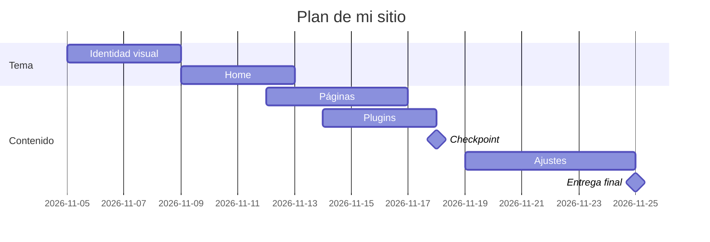

# Plantilla: `decisiones.md`

Copia este contenido en un archivo `decisiones.md` en la carpeta `proyecto/` de tu repo y complétalo. Es la **Sumativa 2** (25 pts), y en el checkpoint (18 nov) lo corriges. Sin informe largo.

---

# Decisiones de mi sitio

**Emprendimiento:** Fajardo Motors V  
**Fecha:** 25 de noviembre · **Última corrección:** 18 de noviembre (Checkpoint)

## 1. Plugins (10 pts)

| # | Funcionalidad | Plugin | Gratis o de pago | Qué incluye la versión gratis | Probado hasta (WP) | Requiere PHP | ¿Funciona con tema propio? | Enlace a la ficha |
|---|---|---|---|---|---|---|---|---|
| 1 | SEO (obligatorio) | Yoast SEO | Gratis, con versión Premium de pago | Análisis de palabra clave y legibilidad, metadatos, mapa del sitio XML y datos estructurados básicos | 7.0 | 7.4 | Sí, agrega metadatos y no depende del diseño del tema | https://wordpress.org/plugins/wordpress-seo/ |
| 2 | Contacto (obligatorio) | Contact Form 7 | Gratis | Formularios ilimitados (contacto y cotización del auto), validación, antispam y envío por correo | 7.0* | 7.4* | Sí, funciona con cualquier tema mediante códigos cortos (shortcodes) | https://wordpress.org/plugins/contact-form-7/ |
| 3 | Botón de WhatsApp (contacto rápido) | Click to Chat | Gratis, con versión Pro de pago | Botón flotante de WhatsApp, mensaje prellenado y horario de atención | 7.0* | 7.4* | Sí, el botón se inserta sin modificar el tema | https://wordpress.org/plugins/click-to-chat-for-whatsapp/ |
| 4 | Optimización de imágenes (velocidad de carga) | Smush | Gratis, con versión Pro de pago | Compresión automática, carga diferida (lazy load) y redimensionado de las fotos de autos | 7.0* | 7.4* | Sí, trabaja sobre la biblioteca de medios | https://wordpress.org/plugins/wp-smushit/ |
| 5 | Respaldos (seguridad del sitio) | UpdraftPlus | Gratis, con versión Premium de pago | Respaldo manual y programado, con restauración en un clic y envío a Google Drive | 7.0* | 7.4* | Sí, respalda el tema, los plugins y la base de datos | https://wordpress.org/plugins/updraftplus/ |

\* Dato estimado: confirmar en la ficha del plugin antes de entregar.

## 2. Páginas de la fase 1 (5 pts)

| # | Página | Por qué la elijo (una línea) |
|---|---|---|
| 1 | Inicio (obligatoria) | Presenta la promesa "Compras tranquilo", portada hero, autos destacados y llamados directos a cotizar o hablar por WhatsApp. |
| 2 | Contacto (obligatoria) | Concentra el formulario de cotización, enlace a WhatsApp, horarios y ubicación física para agendar visitas. |
| 3 | Quiénes somos | Genera confianza y credibilidad presentando la trayectoria y seriedad de Fajardo Motors V en la venta de autos usados. |
| 4 | Garantía Fajardo | Explica la garantía mecánica de 3 meses y la inspección en más de 100 puntos clave, que son nuestra principal ventaja competitiva. |
| 5 | Preguntas frecuentes | Resuelve dudas sobre opciones de pago, financiamiento, consignación y documentación legal de transferencia. |

**Páginas que dejo para después:** Autos (catálogo con filtros avanzados), Ficha técnica detallada por auto, Financiamiento con simulador interactivo de cuotas, Términos y Privacidad.

## 3. Plan del tema (5 pts)

- **Nombre del tema:** Fajardo Motors V
- **Custom o descargado:** Custom (tema propio desarrollado a partir de la plantilla base PHP del curso), porque nos permite control total sobre la portada (`front-page.php`), la cuadrícula de autos destacados, las entradas individuales (`single.php`) con barra lateral de widgets y el catálogo por categorías (`archive.php`), manteniendo los estilos y tipografía Poppins sin sobrecargar el sitio con constructores visuales pesados.
- **Carta Gantt** del desarrollo del sitio (5 al 25 de noviembre):

| Etapa | Desde | Hasta | Notas |
|---|---|---|---|
| Identidad visual | 5 nov | 8 nov | Definir paleta automotriz, tipografía Poppins, header con logo y footer con datos de contacto. |
| Home | 9 nov | 12 nov | Portada Hero, autos destacados en stock, últimas guías del blog y pie de página completo. |
| Páginas | 12 nov | 16 nov | Quiénes somos, Contacto (con formulario), Garantía Fajardo y Preguntas frecuentes. |
| Plugins | 14 nov | 17 nov | Instalar y configurar Yoast SEO, Contact Form 7, Click to Chat, Smush y UpdraftPlus. |
| **Checkpoint (18 nov)** | | 18 nov | Revisión del avance, verificación de plantillas y corrección de este documento. |
| Ajustes y formulario | 19 nov | 24 nov | Pruebas de formularios de cotización, versión móvil, SEO en entradas y respaldo general. |
| **Entrega final (25 nov)** | | 25 nov | Revisión final y entrega. |

Versión en diagrama:

## 4. Plan B (5 pts)

| Riesgo | Qué hago | Cuándo se activa (fecha o señal) |
|---|---|---|
| El tema propio no funciona o se rompe | Paso a un tema descargado oficial y liviano (Twenty Twenty-Five) aplicando la paleta y tipografía desde el Editor de estilos y CSS adicional. | Si el tema presenta errores críticos de PHP que impidan su activación en el servidor. |
| Un plugin falla o no es compatible | Lo desactivo y uso una alternativa probada: WPForms Lite en vez de Contact Form 7, o un botón de WhatsApp mediante enlace HTML directo `wa.me`. | Apenas aparezca un conflicto de compatibilidad o pantalla en blanco al activarlo. |
| Se pierde contenido o el sitio se cae tras una actualización | Restauro la última copia de seguridad íntegra mediante UpdraftPlus (respaldo guardado en Google Drive). | Si el sitio no abre o se detecta pérdida de información tras modificar plugins o temas. |
| El formulario no envía los correos | Configuro envío por SMTP con WP Mail SMTP o priorizo el botón flotante de WhatsApp como canal de contacto directo e inmediato. | Si en las pruebas de cotización no ingresan las solicitudes al correo electrónico. |
| Me falta tiempo para terminar todo | Priorizo lo esencial: Inicio, Contacto, Garantía Fajardo y las entradas con SEO, dejando funcionalidades avanzadas como catálogo con filtros para la fase 2. | Si en la semana final de entrega restan detalles visuales o de contenido. |

## Cambios respecto de la Sumativa 2 (solo en el checkpoint del 18 nov)

| Qué cambié | Qué había antes | Por qué | Evidencia (captura o commit) |
|------------|-----------------|---------|------------------------------|
| Tema propio custom ("Fajardo Motors V") basado en plantilla PHP | Tema hijo de Twenty Twenty-Five | Se logró construir con éxito toda la estructura en PHP (`front-page.php`, `single.php`, `archive.php`, `page.php`, `header.php`, `footer.php`) con control total del diseño automotriz y mayor velocidad de carga. | Commits en el repositorio de Git (`hito 1`, `hito 2`, `hito 3`, `hito 4`). |
| Integración de la sección de autos destacados en la portada | Bloque de tasación genérico | Se priorizó exhibir de inmediato 3 vehículos destacados con precios y fichas técnicas para facilitar la cotización de los clientes. | Commit `hito 2: seccion autos destacados`. |

**Decisión:** Continúo con mi tema propio custom (**Fajardo Motors V**). La programación de las plantillas y los estilos CSS responden exactamente a la identidad de la automotora de autos usados y el sitio funciona con un diseño limpio, responsivo y rápido.
