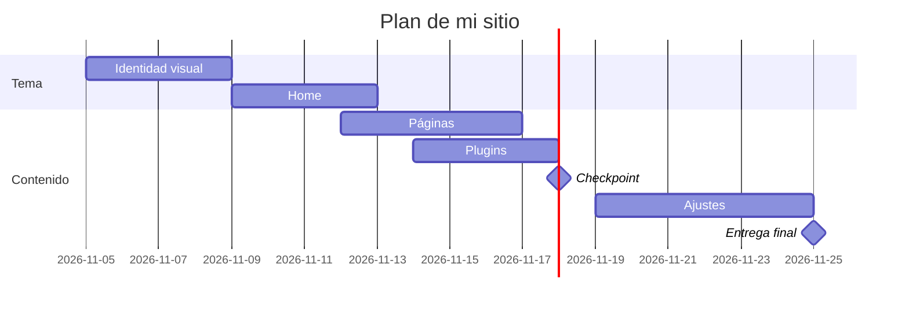

# Plantilla: `decisiones.md`

Copia este contenido en un archivo `decisiones.md` en la carpeta `proyecto/` de tu repo y complétalo. Es la **Sumativa 2** (25 pts), y en el checkpoint (18 nov) lo corriges. Sin informe largo.

---

# Decisiones de mi sitio

**Emprendimiento:** Fajardo Motors V **Fecha:** 25 de noviembre · **Última corrección:** pendiente (checkpoint del 18 de noviembre)

## 1. Plugins (10 pts)

| # | Funcionalidad | Plugin | Gratis o de pago | Qué incluye la versión gratis | Probado hasta (WP) | Requiere PHP | ¿Funciona con tema propio? | Enlace a la ficha |
|---|---|---|---|---|---|---|---|---|
| 1 | SEO (obligatorio) | Yoast SEO | Gratis, con versión Premium de pago | Análisis de palabra clave y legibilidad, metadatos, mapa del sitio XML y datos estructurados básicos | 7.0 | 7.4 | Sí, agrega metadatos y no depende del diseño del tema | https://wordpress.org/plugins/wordpress-seo/ |
| 2 | Contacto (obligatorio) | Contact Form 7 | Gratis | Formularios ilimitados (contacto y cotización del auto), validación, antispam y envío por correo | 7.0* | 7.4* | Sí, funciona con cualquier tema mediante códigos cortos (shortcodes) | https://wordpress.org/plugins/contact-form-7/ |
| 3 | Botón de WhatsApp (contacto rápido) | Click to Chat | Gratis, con versión Pro de pago | Botón flotante de WhatsApp, mensaje prellenado y horario de atención | 7.0* | 7.4* | Sí, el botón se inserta sin modificar el tema | https://wordpress.org/plugins/click-to-chat-for-whatsapp/ |
| 4 | Optimización de imágenes (velocidad de carga) | Smush | Gratis, con versión Pro de pago | Compresión automática, carga diferida (lazy load) y redimensionado de las fotos de autos | 7.0* | 7.4* | Sí, trabaja sobre la biblioteca de medios | https://wordpress.org/plugins/wp-smushit/ |
| 5 | Respaldos (seguridad del sitio) | UpdraftPlus | Gratis, con versión Premium de pago | Respaldo manual y programado, con restauración en un clic y envío a Google Drive | 7.0* | 7.4* | Sí, respalda el tema, los plugins y la base de datos | https://wordpress.org/plugins/updraftplus/ |

\* Dato estimado: confirmar en la ficha del plugin antes de entregar.

## 2. Páginas de la fase 1 (5 pts)

| # | Página | Por qué la elijo (una línea) |
|---|---|---|
| 1 | Inicio (obligatoria) | Presenta la promesa "Compras tranquilo" y lleva a ver autos, cotizar o hablar por WhatsApp. |
| 2 | Contacto (obligatoria) | Concentra el formulario, el WhatsApp, el mapa y la cotización del auto en 24 h, que es el objetivo del sitio. |
| 3 | Quiénes somos | Genera confianza mostrando quiénes somos y por qué trabajamos con transparencia. |
| 4 | Garantía Fajardo | Explica la garantía de 3 meses y el informe de inspección, que son nuestra principal diferencia. |
| 5 | Preguntas frecuentes | Resuelve dudas sobre financiamiento, consignación y documentos antes de que el cliente escriba. |

**Páginas que dejo para después:** Autos (catálogo con filtros), Ficha del auto, Mi selección y visita, Financiamiento con cotizador, Blog (listado), Términos y Privacidad.

## 3. Plan del tema (5 pts)

- **Nombre del tema:** Fajardo Motors (tema hijo de Twenty Twenty-Five)
- **Custom o descargado:** Descargado y personalizado con un tema hijo, porque el plazo es corto (3 semanas) y así reduzco el riesgo de que se rompa, manteniendo mis colores y tipografías.
- **Carta Gantt** del desarrollo del sitio (5 al 25 de noviembre):

| Etapa | Desde | Hasta | Notas |
|---|---|---|---|
| Identidad visual | 5 nov | 8 nov | Instalar el tema, aplicar la paleta, Poppins e Inter, y subir el logo y el favicon. |
| Home | 9 nov | 12 nov | Hero, barra de confianza, autos destacados, bloque de tasación, blog y footer. |
| Páginas | 12 nov | 16 nov | Quiénes somos, Contacto, Garantía y Preguntas frecuentes, más las 2 entradas del blog. |
| Plugins | 14 nov | 17 nov | Instalar y configurar los 5 plugins, probando de a uno. |
| **Checkpoint (18 nov)** | | 18 nov | Revisión del avance y corrección de este documento. |
| Ajustes y formulario | 19 nov | 24 nov | Formulario de cotización, versión mobile, SEO, pruebas y respaldo. |
| **Entrega final (25 nov)** | | 25 nov | Revisión final y entrega. |

Versión en diagrama:

## 4. Plan B (5 pts)

| Riesgo | Qué hago | Cuándo se activa (fecha o señal) |
|---|---|---|
| El tema propio no funciona o se rompe | Vuelvo al tema base sin modificar (Twenty Twenty-Five) y aplico los colores y tipografías desde Apariencia > Editor > Estilos y CSS adicional. | Si el 12 de noviembre la home se ve mal en celular o el tema da error al activarse. |
| Un plugin falla o no es compatible | Lo desactivo y uso una alternativa: WPForms Lite en vez de Contact Form 7, o un botón de WhatsApp con enlace wa.me en un bloque HTML. | Apenas aparezca una pantalla en blanco, un error o un conflicto al instalarlo (pruebo de a un plugin por vez). |
| Se pierde contenido o el sitio se cae tras una actualización | Restauro el último respaldo con UpdraftPlus. Hago respaldo cada semana y antes de cada actualización. | Si el sitio no abre o falta contenido. |
| El formulario no envía los correos | Configuro envío por SMTP con WP Mail SMTP o dejo el WhatsApp como canal principal de contacto. | Si en las pruebas del 19 de noviembre no llega ningún mensaje de prueba. |
| Me falta tiempo para terminar todo | Priorizo lo esencial (Inicio, Contacto y las páginas de confianza) y dejo catálogo, filtros y cotizador como prototipo. | Si en el checkpoint del 18 de noviembre falta más de la mitad de las páginas. |

## Cambios respecto de la Sumativa 2 (solo en el checkpoint del 18 nov)

| Qué cambié | Qué había antes | Por qué | Evidencia (captura o commit) |
|------------|-----------------|---------|------------------------------|
| (se completa en el checkpoint) | | | |

**Decisión:** Continúo con mi propuesta; la confirmo en el checkpoint del 18 de noviembre.
