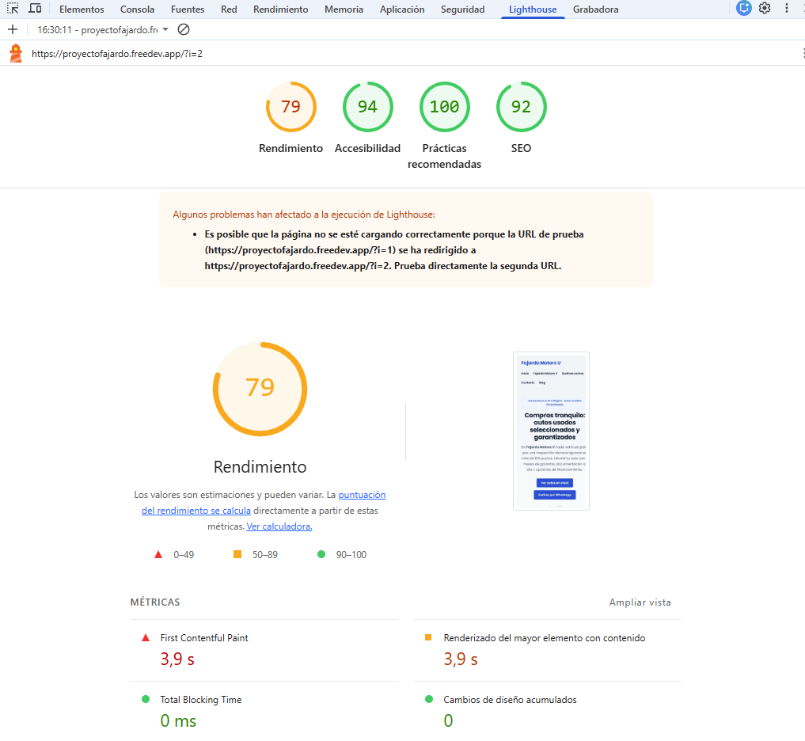

# Análisis de rendimiento con Lighthouse

**Sitio analizado:** https://proyectofajardo.freedev.app/  
**Herramienta:** Lighthouse 13.5.0 en Chrome DevTools (Moto G Power emulado, 4G lenta)  
**Dispositivo:** móvil  
**Fecha del análisis:** 25 de noviembre de 2026, 16:30 GMT-3

## 1. Resultados (1 pt)

| Categoría | Puntaje (0 a 100) |
|---|---|
| Rendimiento | 79 |
| Accesibilidad | 94 |
| Buenas prácticas | 100 |
| SEO | 92 |

**Evidencia:**

*(Nota: el hosting gratuito InfinityFree realiza una redirección inicial de verificación `?i=1` → `?i=2`, lo cual aparece advertido en el propio informe de Lighthouse.)*

## 2. Análisis (1 pt)

- **Qué significan mis puntajes:**
  - **Rendimiento (79/100):** mide la velocidad percibida de carga e interactividad en móvil. Destacan positivamente un **Total Blocking Time (TBT) de 0 ms** y **Cambios de diseño acumulados (CLS) de 0** (la página no salta mientras carga ni bloquea el hilo principal), aunque el **First Contentful Paint (FCP)**, **LCP** y **Speed Index** marcaron **3,9 s**, influenciados por la latencia y redirección del hosting gratuito.
  - **Accesibilidad (94/100):** puntaje muy alto; indica que la mayoría de los textos, imágenes, enlaces y estructura son navegables desde lectores de pantalla y teclado, con solo dos detalles puntuales por ajustar.
  - **Buenas prácticas (100/100):** cumple al 100% con las 13 auditorías revisadas (HTTPS activo, sin errores de consola y librerías seguras).
  - **SEO (92/100):** el sitio es rastreable, tiene viewport móvil correcto y buena estructura semántica, perdiendo algunos puntos únicamente por la falta de metadescripción en la portada.
- **Mi mejor categoría y por qué:** **Buenas prácticas (100/100)** (seguida muy de cerca por Accesibilidad con 94), porque el tema propio `Fajardo Motors V` tiene HTML limpio sin scripts pesados ni errores en consola y el sitio opera sobre HTTPS.
- **Mi categoría más débil y por qué:** **Rendimiento (79/100)**, porque aunque el tema es liviano (`TBT = 0 ms`, `CLS = 0`), la combinación del hosting gratuito InfinityFree (redirección inicial `?i=1` → `?i=2` y TTFB más lento) junto con la carga de fuente externa (`@import`) eleva el FCP y LCP a 3,9 s.
- **Problemas que encontré en el informe:**
  1. **Rendimiento:** FCP y LCP en `3,9 s` y tiempos de vida de caché cortos en recursos estáticos (~5 KiB de ahorro estimado), además de 3 tareas largas señaladas en diagnóstico y la redirección del servidor gratuito.
  2. **Accesibilidad:** contraste insuficiente entre color de fondo y primer plano en algunos elementos, y saltos en el orden secuencial descendente de encabezados (`h1` → `h3`/`h4`).
  3. **SEO:** el documento de inicio **no tiene metadescripción** configurada.

## 3. Mejoras (1 pt)

| Mejora | Qué problema resuelve | ¿Aplicada o propuesta? | Resultado (si la aplicaste) |
|---|---|---|---|
| Configurar una **metadescripción** personalizada para la página **Inicio** desde **Yoast SEO** | Resuelve la única alerta de SEO (*"El documento no tiene una metadescripción"*), subiendo SEO hacia 100 y mejorando cómo se muestra el snippet en Google. | Propuesta (fácil de aplicar en el editor de la página Inicio) | — |
| Corregir el **contraste** de botones/etiquetas y ajustar la jerarquía secuencial de encabezados (`h1` → `h2` → `h3`) en `front-page.php` y `footer.php` | Resuelve las dos alertas de **Accesibilidad** (contraste y orden descendente de encabezados) para llevar Accesibilidad de 94 hacia 100. | Propuesta | — |
| Reemplazar `@import` de Google Fonts en `style.css` por `<link rel="preconnect">` + `<link>` en `header.php` y ajustar reglas de caché en **W3 Total Cache** | Reduce el bloqueo de renderizado inicial (FCP/LCP de 3,9 s) y aprovecha tiempos de vida de caché eficientes en recursos estáticos. | Propuesta *(además ya está activo W3 Total Cache 2.11.0 y Smush 4.3.7)* | — |
