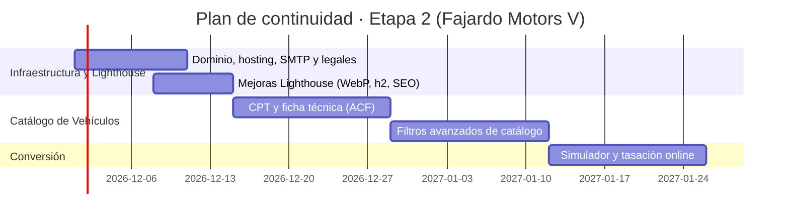

# Plan de continuidad · Etapa 2 de mi sitio

**Emprendimiento:** Fajardo Motors V  
**Sitio de la etapa 1:** https://proyectofajardo.freedev.app/  
**Fecha:** 25 de noviembre de 2026

## 1. Qué quedó fuera de la etapa 1 y por qué (3 pts)

En la etapa 1 se priorizó lanzar la presencia digital de la automotora (portada con autos destacados, promesa "Compras tranquilo", garantía, preguntas frecuentes, blog con SEO y formulario de cotización). Las siguientes funcionalidades quedaron para la etapa 2:

| Funcionalidad | Por qué quedó fuera (tiempo, recursos, costo, conocimientos) | Qué aporta a mi emprendimiento |
|---|---|---|
| Catálogo completo de vehículos con filtros avanzados (marca, año, precio, transmisión, kilometraje) | **Tiempo y conocimientos:** requiere estructurar tipos de entrada personalizados (Custom Post Types) y configurar filtros dinámicos sin sobrecargar el hosting gratuito. | Permite que cada visitante encuentre rápido el auto que se ajusta a su presupuesto y necesidades sin preguntar uno por uno. |
| Ficha técnica individual por auto con galería de fotos y estado de inspección de 100+ puntos | **Tiempo:** implica diseñar una plantilla dedicada para vehículos y cargar fotografías optimizadas e historial real de cada unidad en stock. | Aumenta la transparencia y confianza antes de la visita presencial, reduciendo consultas repetitivas. |
| Simulador interactivo de financiamiento y cálculo de cuotas | **Tiempo y conocimientos técnicos:** requiere lógica de cálculo con pie, plazo y tasas referenciales validadas con entidades financieras. | Ayuda al comprador a evaluar si puede pagar el vehículo en cuotas mensuales antes de cotizar. |
| Módulo de consignación / tasación online con subida de fotos | **Tiempo y recursos:** recibir archivos e imágenes desde formularios públicos exige mayor espacio en disco, validación de seguridad y un servidor sin límites restrictivos. | Captura dueños que quieren vender o dejar su auto en parte de pago, ampliando el inventario de la automotora. |
| Páginas legales completas (Términos y condiciones, Política de privacidad) | **Tiempo y priorización:** se priorizaron las 5 páginas comerciales clave de la fase 1 para cumplir el plazo de entrega. | Da respaldo formal al tratamiento de datos enviados en los formularios de cotización. |
| Mejoras técnicas detectadas en Lighthouse (optimización de imágenes reales a WebP, jerarquía de encabezados `h2`, contraste y metadescripción) | **Tiempo:** se priorizó tener el sitio funcional y publicado en la etapa 1; los ajustes finos de SEO, accesibilidad y reemplazo de imágenes/placeholders por fotos WebP quedan planificados tras el análisis de Lighthouse. | Sube el rendimiento móvil (actual 79) y lleva Accesibilidad (94) y SEO (92) hacia 100, mejorando la conversión y el posicionamiento en Google. |

## 2. Recursos que necesito (2 pts)

| Funcionalidad | Plugin o herramienta | Gratis o de pago | Costo aproximado | Qué tendría que aprender |
|---|---|---|---|---|
| Catálogo y ficha técnica de vehículos | **Advanced Custom Fields (ACF)** o **Pods** | Gratis (con versión Pro opcional) | \$0 CLP (Pro desde ~\$49 USD/año) | Crear Custom Post Types (`vehiculo`), grupos de campos (año, km, transmisión, precio) y mostrarlos en una plantilla PHP (`single-vehiculo.php`). |
| Filtros avanzados en el catálogo | **Filter Everything** o **FacetWP** | Gratis (versión básica) / De pago (avanzado) | \$0 CLP básica / ~\$40–99 USD/año | Configurar taxonomías (marca, categoría) y filtros combinados compatibles con el tema propio. |
| Simulador de financiamiento | **Calculated Fields Form** o desarrollo JS propio en el tema | Gratis (con versión Pro opcional) | \$0 CLP | Fórmulas básicas de cuota mensual y validaciones de entrada en formularios. |
| Envío fiable de correos y notificaciones | **WP Mail SMTP** + correo corporativo del dominio | Gratis | \$0 CLP (incluido en hosting) | Configurar autenticación SMTP (SPF/DKIM) para evitar que las cotizaciones caigan en spam. |
| Páginas legales base | **Complianz** o redacción revisada con asesoría | Gratis (básico) | \$0 CLP | Adaptar textos de privacidad a la ley chilena de protección de datos y uso de formularios. |

**Servidor:** Para la etapa 2 ya no basta un hosting gratuito como InfinityFree (por límites de inodos, espacio, velocidad y restricciones en el envío de correos). Necesitaría contratar un **hosting compartido profesional o VPS básico** (~USD 5 a 15/mes) junto con un **dominio propio `.cl`** (~CLP \$10.000/año en NIC Chile), que cuente con:
- **Espacio:** al menos 10 a 20 GB SSD para almacenar galerías de fotos de vehículos y respaldos.
- **PHP y base de datos:** PHP 8.1 o superior y MySQL 8.0 / MariaDB actualizados.
- **Certificado SSL:** HTTPS activo y renovable automáticamente (Let's Encrypt).
- **Correo corporativo y SMTP:** cuentas `@fajardomotors.cl` sin bloqueos de envío de formularios.

## 3. Priorización y cronograma (2 pts)

Se ordenan las mejoras desde la base técnica y legal hasta las funcionalidades de mayor complejidad (horizonte de 8 semanas):

| Prioridad | Qué hago | Cuándo (mes o semana) | Resultado esperado |
|---|---|---|---|
| 1 | Contratar dominio `.cl` y hosting profesional; migrar el sitio con respaldo, configurar **WP Mail SMTP** para entrega garantizada de formularios y publicar páginas legales (Términos y Privacidad). | Semanas 1 y 2 | Sitio estable en dominio propio sin redirecciones `?i=1`, con HTTPS, correos corporativos confiables y respaldo automático. |
| 2 | Aplicar mejoras de **Lighthouse**: reemplazar imágenes/placeholders por fotos reales en **WebP** con `width`/`height`, corregir jerarquía secuencial de encabezados (`h1` → `h2` → `h3`), contraste y metadescripción en Yoast SEO, y optimizar la carga de Google Fonts. | Semana 2 | Rendimiento móvil sobre 90 (bajando FCP/LCP de 3,9 s) y Accesibilidad/SEO cercanos a 100. |
| 3 | Implementar el Custom Post Type de vehículos (ACF) y crear las plantillas `single-vehiculo.php` y `archive-vehiculo.php` con galería e inspección. | Semanas 3 y 4 | Inventario administrable desde el panel de WordPress con ficha técnica completa por cada auto. |
| 4 | Integrar página **Autos** con catálogo completo y filtros por marca, precio, año y transmisión. | Semanas 5 y 6 | Los visitantes filtran y comparan el stock en tiempo real desde celular y escritorio. |
| 5 | Incorporar simulador de financiamiento en la ficha del vehículo y formulario de tasación/consignación. | Semanas 7 y 8 | Mayor tasa de conversión de leads calificados para venta y captación de autos en parte de pago. |

Versión visual del cronograma:

## 4. Riesgos y mitigación (1 pt)

| Riesgo | Qué haría | Cuándo se activa |
|---|---|---|
| Las fotos de múltiples vehículos ralentizan la carga del sitio | Comprimir imágenes antes de subirlas, convertir a WebP con Smush, activar carga diferida (*lazy load*) y limitar la galería a 6–8 fotos por auto. | Si el puntaje de rendimiento en Lighthouse baja o las páginas superan los 3 segundos de carga. |
| Un plugin de filtros o simulador genera conflicto con el tema propio | Probar primero en un entorno local (Local WP) antes de subir a producción; si falla, reemplazar por otra alternativa de la tabla o código JS ligero propio. | Al aparecer errores PHP, desconfiguración visual o pantalla en blanco tras instalar el plugin. |
| El costo de plugins Pro o hosting supera el presupuesto inicial | Usar versiones gratuitas funcionales (ACF gratis + Filter Everything gratis + JS propio para el simulador) y mantener el plan de hosting inicial básico. | Antes de contratar licencias si el retorno en ventas de la etapa 1 aún no cubre el gasto. |
| Se pierde información al migrar de InfinityFree al nuevo servidor | Generar respaldo completo (archivos + base de datos) con UpdraftPlus y validar la restauración en el servidor nuevo antes de apuntar el dominio definitivo. | Previo a ejecutar la migración de servidor o cambiar los DNS del dominio. |
